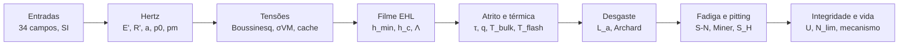
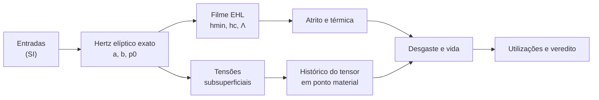

<h1 align="center">TRIBO_SOFT — Engrenamento hipoide / Simulador tribológico de contato lubrificado</h1>

<p align="center">
  <em>Do estudo geométrico de engrenagens espirais e hipóides ao simulador de contato lubrificado:<br>
  Hertz, tensões subsuperficiais, filme EHL, térmica, desgaste, fadiga e pitting, auditados contra soluções analíticas e executáveis no celular.</em>
</p>

<p align="center">
  
  
  
  
  
</p>

<p align="center">
  
</p>
<p align="center"><sub>Os nove gráficos do simulador V7.81 para o caso de referência. .</sub></p>

---

Este repositório reúne **todo o percurso** do TRIBO_SOFT em um só documento: o estudo geométrico que lhe deu origem, o simulador integrado V7.81 com sua auditoria, e a abordagem nova (linha TRIBOCONTATO, até a v11), que reconstrói o modelo sobre o MAIN com os módulos acoplados que o código anterior simplificava. Documenta o **modelo**, as **decisões** e a **verificação**. O programa (Python + Tkinter, roda no celular) é o veículo.

## Sumário

**Parte I — O estudo geométrico (origem)**
- [I.1 Estudo das engrenagens espirais e hipóides](#i1-estudo-das-engrenagens-espirais-e-hipóides)
- [I.2 Da geometria ao modelo matemático de contato](#i2-da-geometria-ao-modelo-matemático-de-contato)
- [I.3 O software inicial](#i3-o-software-inicial)
- [I.4 Evolução para o simulador tribológico](#i4-evolução-para-o-simulador-tribológico)
- [I.5 Escopo e ressalva](#i5-escopo-e-ressalva)

**Parte II — O simulador V7.81 e sua auditoria**
- [II.1 O problema](#ii1-o-problema)
- [II.2 Referências](#ii2-referências)
- [II.3 O trabalho, em quatro etapas](#ii3-o-trabalho-em-quatro-etapas)
- [II.4 Resultados](#ii4-resultados)
- [II.5 A interface](#ii5-a-interface)
- [II.6 Premissas e limites conhecidos](#ii6-premissas-e-limites-conhecidos)
- [II.7 Execução correta não é lógica correta](#ii7-execução-correta-não-é-lógica-correta)

**Parte III — A nova abordagem: MAIN e TRIBOCONTATO (v5 a v11)**
- [III.1 Por que uma nova abordagem](#iii1-por-que-uma-nova-abordagem)
- [III.2 O MAIN](#iii2-o-main)
- [III.3 TRIBOCONTATO, da v5 à v11](#iii3-tribocontato-da-v5-à-v11)
- [III.4 O que a v11 muda](#iii4-o-que-a-v11-muda)
- [III.5 Como a v11 é verificada](#iii5-como-a-v11-é-verificada)
- [III.6 Premissas e limites da v11](#iii6-premissas-e-limites-da-v11)

**Geral**
- [Como executar](#como-executar)
- [Estrutura do repositório](#estrutura-do-repositório)
- [Referências gerais](#referências-gerais)
- [Citação, licença e aviso](#citação-licença-e-aviso)

---

# Parte I — O estudo geométrico (origem)

## 

Esta parte reúne a investigação geométrica e cinemática de engrenagens cônicas espirais e hipóides e o desenvolvimento matemático que antecedeu o simulador tribológico. O software final é uma etapa posterior de um percurso mais amplo: primeiro foram estudadas as superfícies, a geração das curvas e o movimento relativo; depois, essa base foi organizada em um modelo geral de contato e transformada em código.

## I.1 Estudo das engrenagens espirais e hipóides


A investigação aborda a espiral de Arquimedes, sua representação plana e cônica, os ângulos associados à curva e as relações geométricas relevantes para a geração de dentes. Também examina o percurso de contato entre flancos conjugados, distinguindo a trajetória do ponto de contato da linha de contato instantânea.

_2.gif>)

A comparação entre engrenagens espirais de eixos intersectantes e engrenagens hipóides considera o *offset* entre os eixos e suas consequências para a cinemática e para o deslizamento. O estudo também diferencia o contato geométrico ideal do contato sob carga, no qual a deformação elástica modifica a distribuição de pressão e a região efetiva de contato.

Essa etapa fornece a base conceitual para descrever o contato como um fenômeno geométrico e cinemático, e não apenas como uma característica isolada do perfil do dente.

## I.2 Da geometria ao modelo matemático de contato

O desenvolvimento avança para uma estrutura geral aplicável a superfícies engrenadas. A sequência considerada é:

**superfícies parametrizadas → conjugação geométrica e cinemática → linha de contato → movimento relativo → deformação → pressão → microtopologia → comportamento tribológico.**

Essa formulação separa a geometria das superfícies dos fenômenos físicos que surgem quando o contato é carregado e lubrificado. Ela estabelece a ligação entre posição e movimento dos flancos, condições de contato e grandezas necessárias à análise tribológica.

## I.3 O software inicial

A primeira implementação computacional dessa estrutura foi concebida como uma ferramenta genérica: não impõe uma geometria física única, mas recebe expressões paramétricas para as duas superfícies. A versão inicial documentada prevê derivadas numéricas, cálculo das normais, estimativa da velocidade relativa, testes de coincidência geométrica e da condição cinemática **v_rel · n = 0**, busca de candidatos à linha de contato e construção de uma representação do volume tribológico em torno desses candidatos.

Portanto, o software inicial não deve ser confundido com o simulador tribológico integrado posterior. Sua função é estrutural: transformar a descrição matemática das superfícies e do movimento em uma base computacional para identificar e caracterizar o contato.

## I.4 Evolução para o simulador tribológico

Sobre essa linha de desenvolvimento foram organizadas formulações para contato de Hertz, tensões superficiais e subsuperficiais, lubrificação elastohidrodinâmica (EHL), espessura de filme, atrito, aquecimento, desgaste, fadiga e mecanismos de *pitting*. Essas etapas culminaram no simulador integrado, que reúne entradas, cálculos e resultados em uma única aplicação.

O código chegou a aproximadamente 20 mil linhas durante sua evolução. Esse tamanho registra a trajetória do software, mas não constitui, por si só, uma medida da validade matemática ou da necessidade de cada trecho. A avaliação do código e a verificação das fórmulas são atividades distintas da apresentação do estudo geométrico que lhe deu origem.

## I.5 Escopo e ressalva

A Parte I apresenta a etapa anterior ao simulador final: o estudo das engrenagens espirais e hipóides, a passagem para uma formulação geral do contato e a concepção do software inicial. Não substitui a documentação específica do modelo tribológico nem afirma que todas as formulações do desenvolvimento estejam experimentalmente validadas.

---

# Parte II — O simulador V7.81 e sua auditoria

Esta parte documenta o **modelo**, as **decisões** e a **verificação** do simulador integrado.

O ponto de partida foi um simulador anterior de cerca de 20 mil linhas. Ele executava sem erro e imprimia números plausíveis, mas tinha uma fórmula incorreta no campo de tensões, um fator de carga calculado de duas formas diferentes, funções chamadas e nunca definidas, e muito código que nada usava. O trabalho foi auditar, corrigir, enxugar e validar contra soluções conhecidas, registrando o que ainda **não** está validado.

## II.1 O problema

Num contato lubrificado entre dois corpos (esfera contra plano, por exemplo), a carga produz uma pressão de Hertz, essa pressão gera um campo de tensões abaixo da superfície, o filme de óleo separa total ou parcialmente as superfícies e o atrito aquece o contato. Cada um desses efeitos limita a vida do componente por um mecanismo diferente:

- **fadiga subsuperficial**, governada pela tensão de von Mises máxima e por uma curva S-N;
- **pitting**, pela pressão média contra a tensão limite de contato;
- **filme insuficiente**, pelo parâmetro Λ = h_min/Rq;
- **temperatura**, por uma elevação bulk e uma flash;
- **desgaste**, pela fração de carga que as asperezas suportam e pela lei de Archard.

O simulador calcula esses efeitos em cadeia a partir de um conjunto de entradas e responde qual limite é atingido primeiro e em quantos ciclos.

## II.2 Referências

O modelo usa fórmulas fechadas e correlações da literatura. Nenhuma constante empírica foi ajustada neste trabalho (V7.81). As referências da linha TRIBOCONTATOGRACIA estão em [Referências gerais](#referências-gerais).

| Parte do modelo | Fonte |
|---|---|
| Contato de Hertz e campo de Boussinesq | Johnson, K. L. *Contact Mechanics*. Cambridge University Press, 1985. |
| Espessura mínima e central do filme (h_min, h_c) | Hamrock, B. J.; Dowson, D. Isothermal elastohydrodynamic lubrication of point contacts, Parte III. *ASME J. Lubrication Technology*, 1977. |
| Razão de carga das asperezas (L_a, Eq. 23) | Masjedi, M.; Khonsari, M. M. On the effect of surface roughness in point-contact EHL: formulas for film thickness and asperity load. *Tribology International* 82 (2015) 228–244. |
| Desgaste | Archard, J. F. Contact and rubbing of flat surfaces. *J. Applied Physics* 24 (1953) 981–988. |
| Dano acumulado de fadiga | Miner, M. A. Cumulative damage in fatigue. *J. Applied Mechanics* 12 (1945) A159–A164. |
| Critérios de auditoria do código | Al-Khalili, Z.; Howell, N.; Klakow, D. Evaluating intermediate reasoning of code-assisted large language models for mathematics. *Proc. GEM² 2025*, ACL, pp. 741–758. |

O glossário embutido no programa (87 verbetes) registra a fórmula exata usada para cada grandeza.

## II.3 O trabalho, em quatro etapas

### II.3.1 Auditoria do simulador anterior

| Achado | Consequência |
|---|---|
| 20.055 linhas, 580 KB; 227 funções inalcançáveis a partir da interface e do caso de referência (10.846 linhas) | Código morto de versões anteriores; impossível de verificar por inteiro |
| Tensões laterais σx, σy e τxy de Boussinesq com fórmula incorreta | σVM máxima cerca de 12% acima do correto no caso de referência; profundidade do máximo e vida por fadiga erradas |
| Fator de carga do pitting: S_H³ na derivação, S_H² no relatório, e S_H,min ignorado | O mesmo conceito aparecia com dois valores (11,7 e 40,2) |
| 4 funções chamadas e nunca definidas na página de histórico | Os botões "adicionar ponto" e "avaliar histórico" falhavam |
| Campos de R1, R2, uₑ, v_slide e frequência desativados na interface, ou lidos e ignorados pelo código | Entradas que pareciam editáveis e não alteravam o cálculo |
| Cálculo executado no mesmo fluxo da interface | Rolagem e barra congeladas durante a simulação |
| Variáveis atribuídas e não usadas, `import` duplicado, versão inconsistente entre docstring e relatório | Ruído que esconde erros reais |

### II.3.2 Correções matemáticas

**Tensões de Boussinesq.** O termo `(1 − z/R)·x²/r²` de σx deve ser `(1 − z/R)·(x² − y²)/r²` (e simétrico em σy). Em τxy, o primeiro termo leva coeficiente 2, não 1. A forma correta foi derivada de σr e σθ de Johnson e conferida contra a solução analítica no eixo. O ramo r = 0 do código já usava o limite correto, o que denunciava a inconsistência.

**Pitting.** O fator de carga até o limite passou a ser (S_H/S_H,min)³ nos dois lugares, coerente com p_m ∝ F^(1/3) e com a margem macro.

### II.3.3 Reengenharia



- **Tamanho:** de 20.055 linhas e 580 KB para um arquivo de 3.303 linhas e 121 KB, que já inclui os nove gráficos, o glossário e a gravação em TXT.
- **Desempenho:** o campo de tensões ocupava quase todo o tempo. A integração de Boussinesq foi reescrita sem dicionário nem chamada de função por ponto, mantendo a ordem das operações (4,6 s para 1,9 s, resultado idêntico bit a bit). Em seguida, um cache do campo normalizado σ/p0 reaproveita o resultado quando só F, uₑ, v_slide, T₀ etc. mudam.
- **Interface:** página única em cartões, cálculo em segundo plano com barra de progresso, gráficos que aparecem à medida que ficam prontos, rolagem por toque e gravação do relatório em TXT na pasta Download.
- **Entradas:** todos os valores são editáveis.

### II.3.4 Validação e verificação

| Verificação | Resultado |
|---|---|
| E', R', a, p0 e p_m contra as fórmulas fechadas de Hertz | Iguais (erro relativo < 1e-9) |
| ∫ p dA contra F | 1,000002 |
| σz no eixo contra −p0/(1 + z²/a²) | Erro ≤ 0,15% |
| σVM no eixo (ν = 0,3) contra a solução analítica | 0,545 contra 0,5427 (z/a = 0,25); 0,6202 contra 0,6196 (0,5); 0,4712 contra 0,471 (1,0) |
| Máximo de σVM no campo | 0,621·p0 em z/a = 0,5; analítico 0,620·p0 em z/a ≈ 0,48 |
| Antes da correção | σVM no eixo 0,69·p0 em z/a = 0,5 (cerca de 12% acima); σx = −0,109·p0 contra −0,180·p0 analítico |
| Limpeza e otimização contra o original | Relatório idêntico e casos com força, atrito, velocidade, temperatura e ν alterados, todos idênticos bit a bit |
| Cache do campo | Desvio ≤ 2e-14·p0 (arredondamento); relatório idêntico |
| Estrutura do código | Sem nomes indefinidos e sem função morta (verificado por AST) |

A limpeza e a otimização foram verificadas contra o original **antes** das correções matemáticas, para que as duas mudanças não se confundissem.

## II.4 Resultados

Caso de referência: F = 1000 N, contato quase plano (R1 = 10⁶ mm, R2 = 72,5 mm), propriedades de aço nos dois corpos (E = 210 GPa, ν = 0,3).

| Grandeza | Valor |
|---|---:|
| Semi-eixo de contato a = b | 0,7782 mm |
| Pressão máxima p0 / média p_m | 788,5 / 525,7 MPa |
| Tensão de von Mises máxima | 489,6 MPa (U_σ = 0,272), em z = 0,389 mm |
| Filme h_min / h_c | 4,250 / 7,002 µm |
| Λ = h_min/Rq | 10,02 |
| Temperatura total | 62,6 °C |
| U_global | 0,741, governado pela temperatura |
| Vida limite | 5,15 × 10¹⁰ ciclos, por fadiga |

Efeito das correções matemáticas sobre o mesmo caso:

| Grandeza | Antes | Depois |
|---|---:|---:|
| σVM máxima | 550 MPa | 490 MPa |
| Profundidade do máximo | 0,195 mm | 0,389 mm |
| U_σ | 0,306 | 0,272 |
| Vida por fadiga | 1,95 × 10¹⁰ ciclos | 5,15 × 10¹⁰ ciclos |

> [!IMPORTANT]
> As entradas de lubrificação, térmica, desgaste e limites do caso de referência são **estimadas**, e o relatório marca `[ESTIMADO]` nas principais. Os números acima mostram o comportamento do modelo, não um componente real. O arquivo [`exemplo_resultado.txt`](exemplo_resultado.txt) é o relatório completo gravado pelo programa para esse caso, com as tabelas dos nove gráficos.

## II.5 A interface

Uma página rolável, em cartões: entradas agrupadas (contato e materiais, lubrificação e cinemática, térmica e atrito, desgaste, limites, ciclos/fadiga/pitting), execução com barra de progresso, resultados principais, nove gráficos e o relatório técnico.

| # | Gráfico | Varredura |
|:-:|---|---|
| 1 | Pressão de contato p(r) | raio de −a a +a |
| 2 | Tensões × profundidade no eixo (σz, σr, σVM, τmax) | z de 0,1a a 3a |
| 3 | Espessura de filme h_min e h_c × velocidade | uₑ de 0,2 a 2 vezes |
| 4 | Λ × velocidade | uₑ de 0,2 a 2 vezes |
| 5 | Temperatura × velocidade de deslizamento | v_slide de 0,1 a 2 vezes |
| 6 | Integridade (índices U e dano) | estado atual |
| 7 | Curva S-N com o ponto de operação | σ em torno do ponto de operação |
| 8 | Margens × força (U_σ, U_global, S_H) | F de 0,2 a 3 vezes |
| 9 | Evolução por ciclos (D, U_desgaste, U_global) | N de 0 a 1,2·N_lim |

O programa também traz 87 verbetes técnicos com as fórmulas efetivamente usadas e a gravação do relatório completo em `Download/Tribologico_resultado_V781.txt`.

## II.6 Premissas e limites conhecidos

Os limites abaixo fazem parte do resultado.

**Entradas e escopo físico**

- Várias entradas do caso de referência são estimadas (uₑ, η₀, αp, μ, T₀ e os limites). Substitua pelos dados do seu caso.
- A tensão máxima de von Mises vem de uma malha (9 × 9 em x–y, 12 níveis em z); a posição do máximo em z tem passo de 0,25a.
- O campo de tensões usa só a pressão normal. A tração superficial do atrito não entra; com μ alto, as tensões reais perto da superfície são maiores.

**Correlações e simplificações**

- As correlações de h_min, h_c e L_a são empíricas. O modelo **não verifica** se as entradas estão dentro das faixas em que elas foram obtidas.
- A térmica é de forma fechada (flash simplificada e bulk concentrada). Não há acoplamento térmico–EHL.
- A taxa de desgaste é constante no tempo, sem evolução do perfil de contato.
- O coeficiente térmico β é uma entrada que não entra em nenhuma equação.
- Dois critérios de Λ coexistem: U_Λ = 1/Λ (limite em Λ = 1) e Λ mín = h_min,lim/Rq. Eles não são o mesmo limite.
- U_hmin e U_pitting são mostrados, mas não entram no U_global.

**O que foi e o que não foi validado**

- Hertz e Boussinesq foram conferidos contra soluções analíticas. As correlações de EHL, a térmica, o desgaste e a fadiga **não** foram validados contra dados experimentais.
- Toda a verificação automatizada da interface usou *stubs* do Tkinter, nunca Tk real. *(Autor: acrescentar aqui a avaliação visual feita no aparelho.)*
- Desempenho medido só em PC: primeira execução do caso em cerca de 2 s; execuções seguintes, sem mudar ν₁, em milissegundos; gráficos em cerca de 0,2 s. O tempo no celular aparece em "Tempo computacional" no painel de resultados.

Duas dessas limitações, taxa de desgaste constante sem evolução do perfil e atrito constante, são justamente as que a [Parte III](#parte-iii--a-nova-abordagem-main-e-tribocontato-v5-a-v11) ataca.

## II.7 Execução correta não é lógica correta

Este trabalho aplicou ao código os critérios do artigo de Al-Khalili, Howell e Klakow: um programa gerado com assistência de IA pode produzir uma resposta numericamente plausível por um caminho de lógica **não** fundamentada, e métricas de execução não revelam isso. O artigo propõe avaliar a solidez do raciocínio dentro do programa (seis classes, de "conceitual" a "sem lógica") e características estruturais como variáveis definidas e não usadas, usadas e não definidas, número de chamadas e complexidade.

No simulador, o exemplo concreto é o campo de tensões. O programa rodava, o relatório saía completo e os valores tinham ordem de grandeza razoável, mas σx, σy e τxy estavam errados, e só a comparação com a solução analítica no eixo mostrou isso. Daí a regra seguida no trabalho: **cada fórmula crítica é conferida contra uma solução conhecida, e o que não foi conferido está declarado na seção II.6.**

O modelo foi desenvolvido com assistência de IA. Os critérios do artigo foram usados como roteiro de auditoria (código morto, variáveis soltas, nomes indefinidos, complexidade, valores fixos sem origem) e não como uma reprodução do método do artigo.

---

# Parte III — A nova abordagem: MAIN e TRIBOCONTATO (v5 a v11)

## III.1 Por que uma nova abordagem

O V7.81 corrigido é um simulador integrado de contato esfera–plano com muitas saídas. A linha **TRIBOCONTATO** parte de outro lugar: da formulação matemática completa do **MAIN** e do contato **elíptico** aço–aço do hipoide de alta redução, com validação embutida no próprio programa e com nível de confiança declarado para cada módulo. É um programa separado, em Pydroid 3 e Tkinter, só com a biblioteca padrão, que preserva a regra da Parte II: nada crítico sem conferência, e o que não foi conferido, declarado.

## III.2 O MAIN

O **MAIN** (`MAIN_TRIBOSOFT.docx`) é o texto matemático que organiza o trabalho em 39 seções mais os módulos E1–E5. Não reduz o comportamento tribológico a um único critério de falha: trata o contato como sistema acoplado, em que carga, geometria, velocidade, materiais, lubrificação, temperatura e superfície se influenciam. Cobre contato hertziano, tensões subsuperficiais, EHL, espessura de filme, razão de filme Λ, atrito, calor, temperatura de flash, desgaste, micropitting, macropitting, scuffing, critérios de integridade e a interação entre mecanismos.

Dois pontos do MAIN pesam em tudo o que veio depois:

- Ele **já descreve** o acoplamento dinâmico (o desgaste que modifica a geometria real, que modifica a pressão, que modifica o desgaste), mas a formulação computacional operacional (seções 22 e 25) reduz essa cadeia a um fluxo linear e estático.
- A tabela-mestra traz propriedades validadas do aço AISI 8620, mas **não** traz atrito, coeficiente de Archard nem limites de desgaste e temperatura, e a curva S-N de contato tem só dois pontos (800 MPa e 700 MPa).

Por isso a qualidade do modelo varia por módulo, e o MAIN é lido como declaração de limites, não só como fonte de fórmulas.

## III.3 TRIBOCONTATO, da v5 à v11

A linha `TRIBOCONTATO*.py` modela **um** contato elíptico aço–aço com deslizamento rotativo. A cadeia é:



O que cada marco acrescentou, conforme o próprio código registra:

| Versão | Marco |
|---|---|
| **v5** | Valida entradas, converte rpm e horas em ciclos por dente, separa desgaste máximo de desgaste médio na faixa. |
| **v9 → v10** | Integral de Boussinesq com malha graduada de Gauss–Legendre e transformação angular que remove a singularidade da borda. Corrige uma divergência identificada da v9 (σz > p0 em z = 0,1c para k = 7), mantida só para comparação. Tensor completo (6 componentes) em ponto qualquer e **histórico temporal** em ponto material fixo, ligado ao Miner do MAIN 13.22. |
| **Validação externa** | Comparação com dados publicados de hipoides de alta redução (Nakagawa et al., 2024) e de pontos do ciclo de engrenamento (Paouris et al., 2016), com a divisão calibra/valida do MAIN 27.20. Calibrações são registradas e **não aplicadas ao cálculo**. |
| **v11** | Fadiga multiaxial por profundidade, atrito misto, cota de temperatura e desgaste incremental com realimentação (seção seguinte). |

O resultado nunca é apresentado como previsão absoluta de vida: o veredito validado usa só a tensão de von Mises; filme, fadiga, temperatura e desgaste aparecem como indicativos com nível de confiança explícito.

## III.4 O que a v11 muda

A v11 ataca as quatro simplificações do v10 que o MAIN já descrevia como acopladas:

| Simplificação do v10 | Na v11 | Nível |
|---|---|---|
| Desgaste linear sobre elipse fixa, w_N = N·w₁ | Desgaste incremental: o perfil w(y, N) altera a folga, o contato é recalculado em grade, a pressão cai e o desgaste desacelera (Euler modificado, passo controlado por estabilidade) | solver verificado; resultado físico [N] |
| Atrito de Coulomb constante (μ = 0,05) | μ misto: asperezas (forma de Greenwood–Williamson) mais fluido (Eyring) | limites e integrais verificados; parâmetros [N] |
| Blok sem solução para Pe < 10 | Blok mantido; para Pe < 10 informa uma **cota superior estacionária**, não uma temperatura estimada | identidades verificadas |
| S-N de dois pontos sobre a pressão superficial | S-N reescrita em Φ(z) = τ_amp + λ·p_hid,max, com dano D(z) por profundidade | identidades verificadas; λ e H(z) pendentes |

Exemplo (K reduzido a 2·10⁻¹¹ para ficar no regime em que a malha converge): o desgaste no centro é 41,5 µm contra 118,5 µm do cálculo linear estático; a pressão máxima cai de 843 para 456 MPa; a área de contato cresce 1,71 vezes. É o efeito de conformidade que o v10 não podia mostrar.

Os módulos novos são **opt-in** (botões próprios) quando custam mais que o cálculo padrão. A formulação completa está em `MAIN_NOVO_v11.docx`.

## III.5 Como a v11 é verificada

Cada teste carrega um nível, e o relatório os exibe:

| Nível | Significado |
|:-:|---|
| **V** | Verificação matemática: identidade ou solução fechada |
| **R** | Referência analítica publicada, comparada numericamente |
| **C** | Calibrado em dado externo |
| **E** | Comparação com dado externo |
| **N** | Não validado |

Três conjuntos de testes executam pela linha de comando:

| Comando | Resultado (ambiente de desenvolvimento) |
|---|---|
| `--validar` | 69 de 69 (V 32 · R 10 · E 27) |
| `--validar-hist` | 47 de 47 |
| `--validar-v11` | 37 de 37 |

Esses números pedem leitura cética, e o repositório diz como:

- Parte dos testes são **identidades por construção** (por exemplo, o dano na profundidade crítica igual ao dano em pH depois da calibração). Elas verificam fiação e unidades, não física.
- Os testes com conteúdo físico independente incluem: núcleo de Love contra quadratura; contato em grade contra Hertz exato (erro de 0,3% na pressão máxima); hidrostática no eixo contra Johnson; escalamento de Φ; integral do fluido contra grade cartesiana; limites de Eyring; convergência do desgaste com refino de malha e de passo.
- **As tolerâncias da v11 foram fixadas depois de prototipar o solver**, e as de `--validar` até 21/10/2026 sem registro prévio. Pelo critério 28.26 do MAIN, devem ser tratadas como posteriores ao resultado. Nenhuma tolerância deve ser alterada para um teste passar.
- Nenhum dado externo novo foi usado na v11.

## III.6 Premissas e limites da v11

Fazem parte do resultado:

- **Escopo:** um contato elíptico, não multicontato. Atrito não entra no campo de tensões (só pressão normal).
- **Filme:** hmin vem da fórmula do MAIN (Hamrock–Dowson) ou, no arrastamento angular, de uma variante calibrada nos nove pontos do Paouris (domínio restrito: u_e de 1,5 a 8,7 m/s, F de 230 a 10.600 N, k de 7 a 30).
- **Parâmetros que o MAIN não fornece**, com valores padrão **ilustrativos**: atrito, K de Archard, μ das asperezas (0,12), τ₀ de Eyring (5 MPa) e λ da fadiga (0,3).
- **Fadiga:** a S-N tem dois pontos; fora de 700–800 MPa é extrapolação. O perfil de dureza H(z) do aço cementado não está incluído. A margem G_sub do MAIN continua sem R_sub nem Φ_sub.
- **Desgaste incremental:** w depende só de y (ângulo de arrastamento ignorado), N igual nos dois corpos, K e H constantes. Com o K padrão (2·10⁻⁹) o desgaste é da ordem de 10 mm; o laço para em 60 passos e o relatório marca *INCOMPLETO*, porque nesse regime o semiespaço elástico já não se sustenta. A pressão máxima é sensível à malha nas bordas de sulco; o relatório traz também uma medida mais estável (p0eq).
- **Temperatura:** a cota estacionária é um teto, muito conservador em deslizamento rápido, não uma estimativa. Não há acoplamento térmico–EHL, nem realimentação do desgaste para o filme.
- **Interface:** a verificação automatizada nunca usou Tk real. A avaliação visual no aparelho e o tempo de execução no celular ainda precisam ser registrados pelo autor.

---

# Geral

## Como executar

**Requisitos:** Python 3 e Tkinter. Sem NumPy nem matplotlib. Alvo: Pydroid 3 (Android).

**Programa atual (TRIBOCONTATO v11):**

```bash
python TRIBOCONTATOGRACIA11.py                 # interface gráfica
python TRIBOCONTATOGRACIA11.py --validar       # validação do núcleo, com dados externos
python TRIBOCONTATOGRACIA11.py --validar-hist  # testes do histórico de tensões
python TRIBOCONTATOGRACIA11.py --validar-v11   # testes dos módulos da v11 (cerca de 8 s num PC)
python TRIBOCONTATOGRACIA11.py --historico     # relatório com histórico e S-N em Φ
```

Na interface: **CALCULAR** roda o cálculo padrão; **HISTÓRICO DE TENSÕES** e **DESGASTE INCREMENTAL** são mais lentos e opcionais; **Mostrar módulos não calibrados** exibe temperatura, atrito, desgaste, vida e rendimento. **SALVAR TXT** grava o relatório na pasta Download.

**Simulador V7.81 (Parte II):**

```bash
python modelo_tribologico.py        # interface gráfica
```

No Pydroid 3, abra o arquivo e execute. Ajuste os campos, toque em **EXECUTAR** e acompanhe a barra de progresso. **GRAVAR TXT** salva o relatório e as tabelas dos gráficos em `Download`. **VERBETES TÉCNICOS** abre o glossário.

O caso do V7.81 também pode ser calculado sem interface:

```python
from modelo_tribologico import run_v776_reference_case
resultado, relatorio = run_v776_reference_case()
print(relatorio)
```

## Estrutura do repositório

```text
.
├── README.md                    # este documento (histórico completo + nova abordagem)
├── SBP_2236-1.jpg               # Parte I: imagem da engrenagem hipóide
├── 20260922_123620.jpg          # Parte I: desenho geométrico
├── Eloid spiral bevel gear cutting sim(360P)_2.gif   # Parte I: simulação de corte
├── MAIN_TRIBOSOFT.docx          # MAIN original (39 seções + E1–E5)
├── MAIN_NOVO_v11.docx           # formulação operacional da v11, com níveis e premissas
├── modelo_tribologico.py        # Parte II: simulador V7.81 (modelo + interface + gráficos + glossário)
├── graficos.png                 # Parte II: figura do topo
├── exemplo_resultado.txt        # Parte II: relatório do caso de referência
├── TRIBOCONTATOGRACIA10.py      # Parte III: versão anterior, preservada
└── TRIBOCONTATOGRACIA11.py      # Parte III: programa atual
```

## Referências gerais

| Parte do modelo | Fonte | Onde é usada |
|---|---|---|
| Contato de Hertz, campo de Boussinesq, contato de linha | Johnson, K. L. *Contact Mechanics*. Cambridge University Press, 1985. | II e III |
| Filme EHL (h_min, h_c) | Hamrock, B. J.; Dowson, D. Isothermal elastohydrodynamic lubrication of point contacts, Parte III. *ASME J. Lubrication Technology*, 1977. | II e III |
| Razão de carga das asperezas (L_a, Eq. 23) | Masjedi, M.; Khonsari, M. M. *Tribology International* 82 (2015) 228–244. | II |
| Desgaste | Archard, J. F. *J. Applied Physics* 24 (1953) 981–988. | II e III |
| Dano acumulado de fadiga | Miner, M. A. *J. Applied Mechanics* 12 (1945) A159–A164. | II e III |
| Filme com arrastamento angular e dados de validação | Paouris, L. et al. *Proc. IMechE Part C* 230 (7–8), 2016. | III |
| Hipoides de alta redução (dados de validação) | Nakagawa et al. *Trans. JSME* 90 (939), 2024. | III |
| Relações geométricas e de força do hipoide | Stadtfeld, H. J. *Gear Technology*, ago. 2011. | III |
| Temperatura de flash | Blok (fonte móvel, partição por temperaturas iguais), conforme MAIN seções 11 e 20. | III |
| Critérios de auditoria do código | Al-Khalili, Z.; Howell, N.; Klakow, D. Evaluating intermediate reasoning of code-assisted large language models for mathematics. *Proc. GEM² 2025*, ACL, pp. 741–758. | II e III |

## Citação, licença e aviso

Se usar este trabalho, cite também as fontes acima.

> [!IMPORTANT]
> Este é um modelo de estudo. Não é uma ferramenta validada para projeto de componentes. Os números absolutos de vida e de desgaste devem ser lidos como tendências, não como previsões, até que os parâmetros marcados [N] sejam calibrados com dados do par real.

